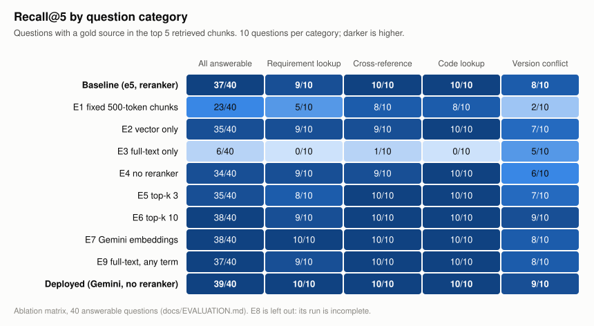
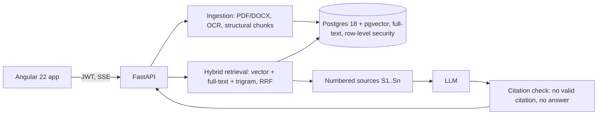

# Normeon

A RAG assistant for German technical documentation — regulations,
Lastenhefte, manuals — that answers with citations the backend has
checked, and says `NICHT_GEFUNDEN` instead of guessing.

[](https://github.com/MihaelaAghirculesei/normeon-german-technical-rag/actions/workflows/ci.yml)
[](LICENSE)

<!-- Demo GIF: question → sources → streamed answer → citation → PDF page. -->

## Live demo

<https://normeon.onrender.com> — sign in as `anna@demo.normeon.dev`
(admin of the demo tenant, which holds the corpus) or
`ben@zulieferer.normeon.dev` (a second tenant that sees none of it), both
with the password `normeon-demo`.

It runs on free tiers: the first request after an idle period waits for a
cold start (30-60 s), and without a persistent disk the citation panel
shows the cited text rather than the original PDF. The corpus is two
public German traffic regulations (StVZO, FZV) and two synthetic
Lastenheft versions that contradict each other on purpose. Try
*„Welche Lenkkraft fordert das Lastenheft?“* or
*„Wie breit darf ein Pkw nach StVZO sein?“*.

## Results

Measured on a hand-written set of 50 German questions, 10 per category
(requirement lookup, cross-reference, code lookup, unanswerable, version
conflict), with one knob changed per configuration:

<picture>
  <source media="(prefers-color-scheme: dark)" srcset="docs/img/recall-by-category-dark.svg">
  
</picture>

| | Development baseline | Deployed demo |
| --- | --- | --- |
| Configuration | e5-large, hybrid, cross-encoder | Gemini embeddings, hybrid, no reranker |
| Recall@5 (40 answerable) | 0.925 | **0.975** |
| Answer accuracy (50) | **0.840** [0.74, 0.94] | 0.800 [0.68, 0.90] |
| Unanswerable questions declined | 10 / 10 | 10 / 10 |
| Answers citing an invented source | 0 | 0 |

What the numbers say:
- **Retrieval is not the bottleneck.** Nine of the deployed demo's ten
  wrong answers are abstentions, eight of them with the gold source in
  the context. The model declines more than it should (#38).
- **Hybrid earns its place.** Vector-only retrieval costs 8 points of
  answer accuracy, the one single-component difference the sample
  resolves; full-text alone finds a gold source for 6 of 40 questions.
- **More context is not better.** Ten chunks give the best recall and the
  worst accuracy of the hybrid configurations (0.720): the model abstains
  more often, not less.
- **The judge was checked by hand:** it agreed with my scores on 15 of
  15 questions, which bounds its agreement at 0.80 or better (95%).

Method, confidence intervals and paired comparisons:
[`docs/EVALUATION.md`](docs/EVALUATION.md). Reproduce the chart with
`backend/scripts/plot_recall_by_category.py`.

## Architecture



Every source reaches the model as delimited, untrusted text; a marker
the model invents is dropped, and an answer left without a real citation
becomes `NICHT_GEFUNDEN`. Tenants are separated twice: by the
application's queries and by Postgres row-level security under a
non-superuser role, and the security tests check each layer on its own.
Details: [`docs/ARCHITECTURE.md`](docs/ARCHITECTURE.md).

## Stack, and why

| Part | Choice | Why |
| --- | --- | --- |
| Storage and search | PostgreSQL 18 + pgvector | Vectors, German full-text, trigrams and row-level security in one transactional store (ADR 0001) |
| Fusion | Reciprocal Rank Fusion | Branch scores are not comparable; ranks are (ADR 0002) |
| Chunking | One chunk per document section | +35 points of recall over fixed windows (ADR 0003) |
| Embeddings | `multilingual-e5-large` locally, `gemini-embedding-2` in the demo | Measured against each other (E7) |
| Reranker | `bge-reranker-v2-m3`, off in the demo | Adds recall to e5 (within noise), lowers it with Gemini embeddings (E4, E7) |
| Backend | Python 3.13, FastAPI, SQLAlchemy async | Typed end to end: mypy strict, Pydantic |
| Frontend | Angular 22, zoneless, signals | API types generated from the OpenAPI document, checked in CI |
| Deployment | Render + Neon + Gemini, free tiers | A public demo at zero cost (ADR 0005) |

## Run it locally

Docker only — API, database and the two demo users, with an offline fake
model (no API key):

```bash
git clone https://github.com/MihaelaAghirculesei/normeon-german-technical-rag.git && cd normeon-german-technical-rag
docker compose up -d --build
docker compose exec backend sh -c "alembic upgrade head && python -m app.db.seed"
```

`curl localhost:8010/health` answers once it is up; the first build
produces a 2.4 GB image (CPU torch, tesseract). Ports are offset from
the defaults (8010, 5433, 8081 for Adminer).

The full stack, with real answers and the corpus, runs from source
(Python 3.13, Node 22.22.3+; Windows paths, `.venv/bin/` elsewhere):

```bash
docker compose up -d db
cd backend && python -m venv .venv && .venv/Scripts/pip install -e ".[dev,local]"
cp ../.env.example .env   # then add LLM_PROVIDER, LLM_API_BASE_URL, LLM_API_KEY, LLM_MODEL
.venv/Scripts/alembic upgrade head && .venv/Scripts/python -m app.db.seed
.venv/Scripts/python scripts/ingest_corpus.py   # embeds the corpus with e5 on CPU: slow
.venv/Scripts/uvicorn app.main:app --app-dir src --port 8010
cd ../frontend && npm ci && npm start           # http://localhost:4210
```

Any OpenAI-compatible endpoint works for answers; the evaluation used
Gemini's free tier. Before contributing: `git config core.hooksPath
scripts/hooks` enables a pre-push hook that blocks pushes to `main` and
runs the CI checks first. After changing an endpoint, regenerate
`backend/openapi.json` (`scripts/export_openapi.py`) and the frontend
types (`npm run gen:api`); CI checks both.

## Known limits

Measured where it could be, in [`docs/FAILURE-MODES.md`](docs/FAILURE-MODES.md):
- The model over-abstains: most wrong answers decline although the
  answer is in the context (#38).
- German compound nouns are not split by the full-text stemmer
  (*Fahrzeugzulassung* does not match *Zulassung*); the vector branch
  covers part of it.
- An all-terms full-text query matches none of the 50 evaluation
  questions on its own; recall comes from the vector and trigram branches.
- A table that continues on the next page becomes two tables, the second
  without its header.
- Scanned pages are only as good as their OCR, and are labelled as OCR.
- The index parameters are tuned for a corpus of about 1,200 chunks;
  tens of thousands would need them measured again.

## Documentation

- [`docs/ARCHITECTURE.md`](docs/ARCHITECTURE.md) — how a question becomes a cited answer
- [`docs/EVALUATION.md`](docs/EVALUATION.md) — question set, metrics, every run
- [`docs/FAILURE-MODES.md`](docs/FAILURE-MODES.md) — where it is not reliable, with numbers
- [`docs/adr/`](docs/adr/) — architecture decisions
- [`docs/RUNBOOK.md`](docs/RUNBOOK.md) — the demo database: backup, restore, corpus

## License

Code is released under the [MIT License](LICENSE).

The documents under `corpus/` are not covered by that license and keep
their own terms: `StVZO.pdf` and `FZV.pdf` are official German
regulations (amtliche Werke, § 5 UrhG — no copyright), and the
`Lastenheft-EPS-*.docx` files are synthetic samples written for this
project. See `corpus/manifest.yaml` for the provenance of each file.
