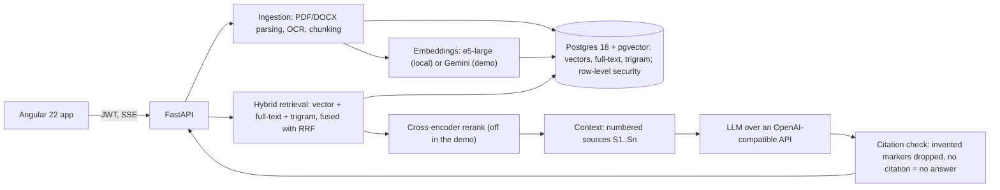

# Architecture

How a question becomes a cited answer, and what each part does. Decisions
and their reasons are in `docs/adr/`; measured weaknesses are in
`docs/FAILURE-MODES.md`.

## Ingestion

Structured German PDF parsing (PyMuPDF: blocks with page, box, font and
bold; titles from font size or numbering; tables to markdown; repeated
headers and footers dropped) and DOCX parsing from heading styles.
Scanned pages are read by OCR (tesseract, German) and labelled as such.
Two chunking strategies run side by side: fixed 500-token windows and
structural chunks, one per leaf section with a breadcrumb (ADR 0003 makes
structural the default, with numbers). Ingestion is idempotent: a
document is identified by its content hash, chunks by theirs, so the same
file is never processed twice, not even when it arrives again while the
first copy is still being processed. Each chunk keeps the page and box of
the blocks it came from, so the viewer can mark the passage in the PDF.

## Retrieval

Tenant-scoped vector k-NN over an HNSW index; German full-text search
with requirement-code normalisation (`LH 3.2.1`, `LH-3.2.1` and `LH3.2.1`
are one token) and a trigram fallback for codes; the three branches fused
with Reciprocal Rank Fusion (ADR 0002). A single instrumented pipeline --
hybrid, cross-encoder rerank, token-budget context selection -- is
exposed at `POST /api/v1/search` with per-phase timings.

## Generation

A versioned German answer prompt; a context builder that assigns stable
`[S1]` markers and keeps the marker → page/section mapping on the
server. Retrieved text reaches the model as delimited, untrusted data,
without filenames or pages. Citation validation drops any marker the
model invents and treats an answer without a valid citation as an
abstention (`NICHT_GEFUNDEN`) rather than showing it as if it were
grounded. A confidence gate skips the model call when retrieval comes
back empty. When sources of different versions disagree on a requirement
code, the model is asked to say so. LLM calls are retried with typed
errors and a per-attempt deadline, so a provider outage is a clear HTTP
response, not a bare 500. `POST /api/v1/chat/stream` (SSE) sends the
sources before the answer starts streaming, keeps the connection alive
with heartbeats, and stops the model call when the client disconnects.
Every answer writes a `query_logs` row: tokens, cost (from a versioned
`pricing.yaml`), per-phase latency, configuration fingerprint and the
retrieved chunks.

## Evaluation

A hand-written 50-question German set, 10 per category: requirement
lookup, cross-reference, code lookup, unanswerable, version conflict.
Answers are scored in two layers, a deterministic point match and an LLM
judge, and the judge was checked against 15 questions scored by hand
(agreement 15/15). Metrics: recall/MRR/precision@k, citation precision,
hallucinated-citation rate, answer accuracy, correct and false
abstention rate, latency percentiles, cost per query, all with bootstrap
confidence intervals and paired comparisons between configurations.
`docs/EVALUATION.md` has the runs and what they showed.

## Frontend

Angular 22 (zoneless, signals). The API types are generated from the
backend's OpenAPI document, and CI fails on any drift between the two,
the SSE frames included. The chat page streams over `fetch` +
`ReadableStream` (POST, so not `EventSource`), names the pipeline phase a
request is in, shows the sources before the first word of the answer,
and can cancel a running request, which also stops the model call on the
server. Every `[S1]` is a chip that opens the cited passage between the
text before and after it, with document, version, section and page; for
a PDF, one more click opens the original at that page with the passage
marked (pdf.js). Documents are uploaded by drag and drop and followed
through ingestion. An admin statistics page shows the tenant's numbers.

## Security

Login issues a short-lived JWT carrying the user's tenant and role; the
tenant comes from that token only, never from the request. Isolation has
two layers: the application filters every query on the tenant, and
Postgres row-level security enforces the same boundary underneath. The
app switches to a dedicated non-superuser role in every tenant-scoped
transaction, because a superuser connection would bypass every policy
(ADR 0004). `tests/security` proves both layers hold, each on its own,
and runs a prompt-injection suite against a model that obeys injected
instructions. Uploads are checked before anything is stored: oversized
requests are refused from their headers, encrypted, broken and zip-bomb
files with a clear message, and parsing has a deadline.

## Observability

Every request carries an id (`X-Request-ID`) that is on every JSON log
line, the trace and the `query_logs` row. OpenTelemetry spans cover
parsing, embedding, each retrieval branch, fusion, rerank and generation;
in development each request logs one readable trace. `/metrics` exposes
Prometheus metrics: latency per phase, cost, answers by outcome, invented
citations and LLM errors.

## Deployment

The public demo runs on free tiers only (ADR 0005): one Docker service on
Render serving the API and the built frontend, Postgres with pgvector on
Neon, answers and embeddings from the Gemini API. The image has no torch,
so embeddings come from `gemini-embedding-2` and there is no reranker --
measured, not assumed: with Gemini embeddings the cross-encoder lowers
recall (E7 in `docs/EVALUATION.md`). Per-IP rate limits and a daily
question budget protect the free quota. A nightly encrypted dump backs up
the database; `docs/RUNBOOK.md` covers restoring it and loading the demo
corpus.
